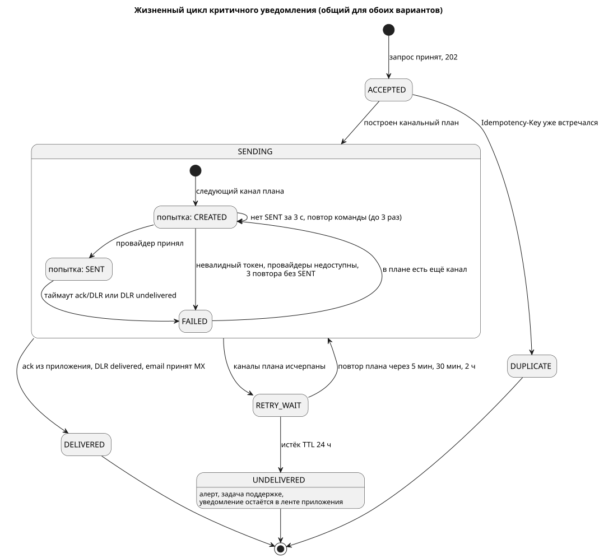
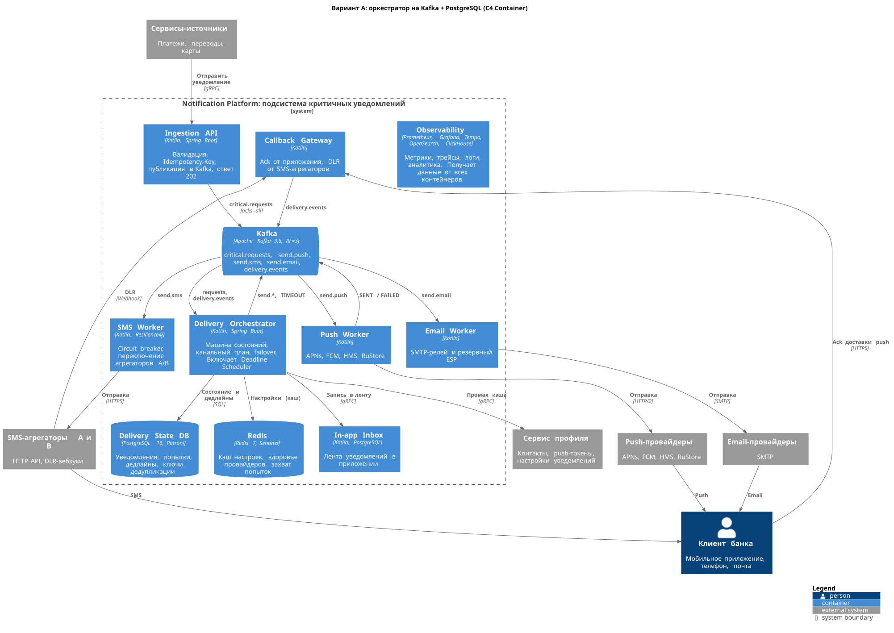
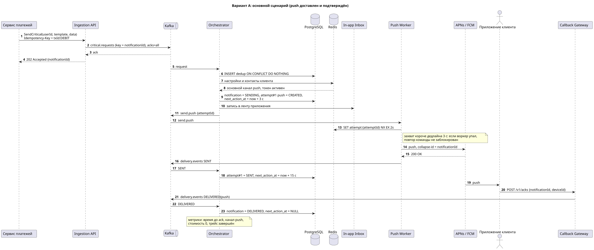
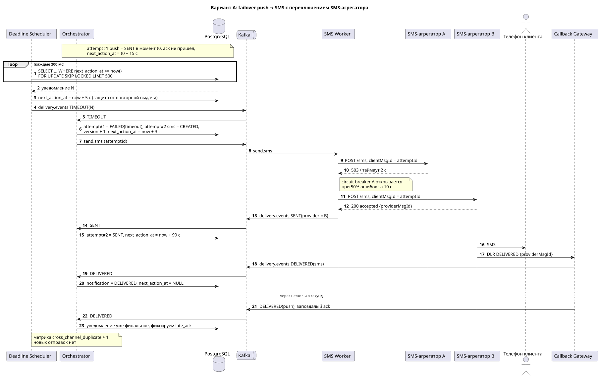
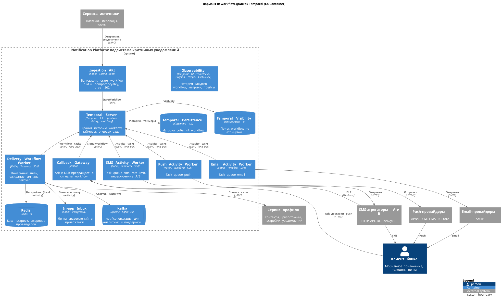
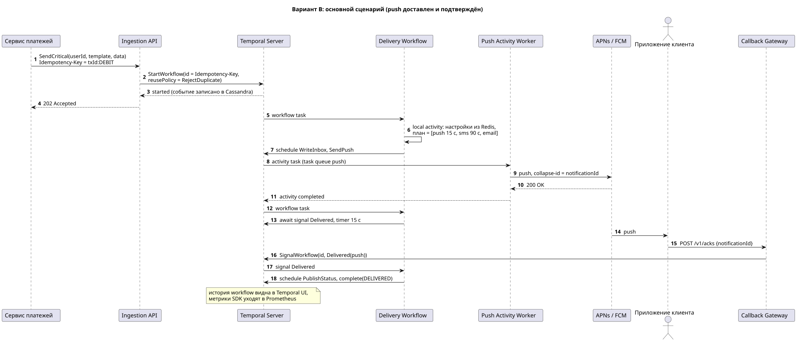
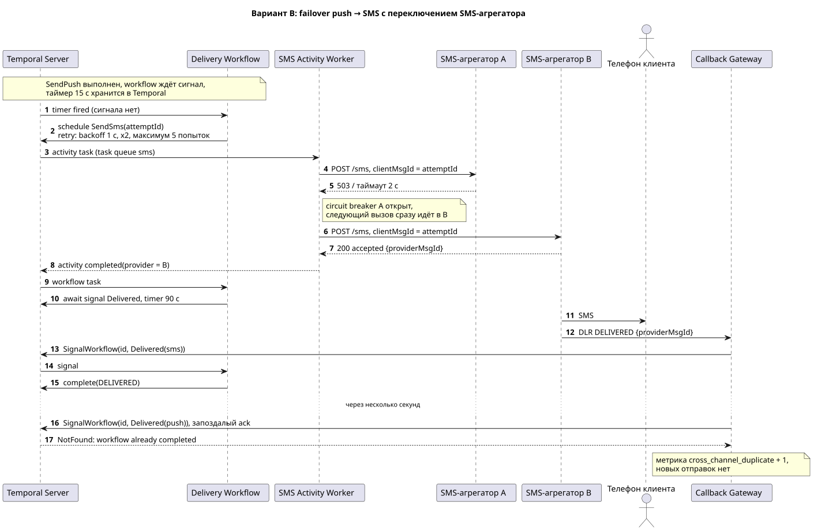

# RFC-001. Гарантированная доставка критичных уведомлений с кросс-канальным failover

- **Статус:** Accepted (2026-11-17), решение в [разделе 10](#10-решение).
- **Создан:** 2026-11-15.
- **Ревьюеры:** платежи, карты, мобильное приложение, SRE, ИБ, юристы.
- **Связано:** [requirements.md](requirements.md), требования и ASR всей платформы.

## 1. Кратко

Подсистема принимает транзакционные уведомления, надёжно сохраняет их и доставляет по канальному плану: push, затем SMS, затем email. На следующий канал переходим, если нет подтверждения доставки: ack из приложения или DLR от SMS-агрегатора. Таймеры хранятся в БД и переживают рестарты.

Рассмотрены два варианта: своя машина состояний на Kafka + PostgreSQL (A) и Temporal (B). **Выбран A:** он закрывает все ASR на уже эксплуатируемом стеке, с запасом по нагрузке и меньшим операционным риском.

Ожидаемый эффект: доля SMS ~30% вместо 100% (~380 млн ₽ экономии в месяц), ≥ 99,9% уведомлений подтверждены за 5 мин.

## 2. Контекст и цели

Сейчас команды шлют уведомления сами. Нет единой политики каналов, ретраи частично в памяти (потери при деплое, дубли при повторах), нет переключения на резервный канал, поддержка не видит статус. Транзакционные уведомления критичны: через них клиент узнаёт о мошенничестве, а банк выполняет 161-ФЗ ст. 9.

**Цели:** доставка хотя бы по одному каналу, failover между каналами и провайдерами, учёт настроек, минимальная стоимость, без дублей, наблюдаемость.

**Не-цели:** OTP-коды (другие SLA), маркетинговые и сервисные уведомления (общий контур платформы), шаблоны, выбор конкретных агрегаторов.

## 3. Требования

Пользовательские сценарии описаны в [requirements.md](requirements.md#1-функциональные-требования) (FR-2, FR-3, FR-4, FR-8, FR-10, FR-12, [UC-1](requirements.md#11-use-case-uc-1-доставка-уведомления-об-операции)). Здесь они детализированы до поведения подсистемы.

### 3.1 Функциональные

| ID | Требование | Из чего | Приоритет |
|---|---|---|---|
| RF-1 | Приём подтверждается только после надёжного сохранения | FR-2 | Must |
| RF-2 | Канальный план строится по классу события, настройкам и доступности каналов | FR-3, FR-10 | Must |
| RF-3 | Нет подтверждения за таймаут или ошибка провайдера: переход к следующему каналу | FR-2, UC-1 4a | Must |
| RF-4 | Каналы исчерпаны: повторы через 5 мин, 30 мин, 2 ч. Через 24 ч статус UNDELIVERED и алерт | FR-2, UC-1 4b | Must |
| RF-5 | Повторный запрос с тем же ключом идемпотентности не создаёт уведомления | FR-4, UC-1 2a | Must |
| RF-6 | После подтверждения по любому каналу оставшиеся шаги отменяются | FR-4, FR-10 | Must |
| RF-7 | Канал, у которого отказали все провайдеры, пропускается без ожидания таймаута | FR-2 | Should |
| RF-8 | Каждое уведомление пишется в ленту приложения | FR-12 | Should |
| RF-9 | Поддержка видит историю попыток: канал, провайдер, ответ, время | FR-8 | Should |

### 3.2 Нефункциональные

Способ измерения и обоснование цифр приведены в [requirements.md](requirements.md#2-нефункциональные-требования). Здесь только значения для подсистемы.

| ID | Требование | Основа | Приоритет |
|---|---|---|---|
| NF-1 | Ответ API p99 ≤ 200 мс, до провайдера p99 ≤ 1 с | NFR-1 | Must |
| NF-2 | Push на устройстве p95 ≤ 3 с, с failover p99 ≤ 60 с | NFR-1 | Must |
| NF-3 | RPO = 0, ≥ 99,9% подтверждены за 5 мин | NFR-3 | Must |
| NF-4 | Доступность приёма 99,99%, RTO ≤ 5 мин | NFR-4 | Must |
| NF-5 | 2000 уведомлений/с, рост до 5000/с узлами | NFR-2 | Must |
| NF-6 | Дубли ≤ 0,01% в канале, ≤ 3% между каналами | NFR-6 | Must |
| NF-7 | Переключение провайдера ≤ 30 с | NFR-7 | Must |
| NF-8 | Журнал ≥ 3 лет, ПДн в РФ | NFR-11 | Must |
| NF-9 | Доля SMS ≤ 30% | NFR-9 | Should |
| NF-10 | Статус у поддержки ≤ 5 с, алерт ≤ 5 мин, trace id у 100% | NFR-8 | Should |
| NF-11 | План и таймауты меняются без релиза | NFR-14 | Should |

### 3.3 Настройки клиента

Транзакционные отключить нельзя. Основной канал: push (по умолчанию) или SMS (платное SMS-информирование), второй становится резервным. Email можно отключить. Если push запрещён в ОС, план начинается с SMS. Тихие часы не применяются.

## 4. ASR и приоритеты

Номера и приоритеты из [requirements.md, задание 3](requirements.md#3-архитектурно-значимые-требования-asr). ASR-3 (кампании) к подсистеме не относится.

| ID | ASR | Приоритет | Требования |
|---|---|---|---|
| ASR-1 | Ни одно принятое уведомление не теряется и доставляется хотя бы по одному каналу, в том числе без сервиса настроек | P1 | RF-1, RF-2, RF-3, RF-4, NF-3, NF-4, NF-8 |
| ASR-2 | Низкая задержка, изоляция от массового трафика | P1 | NF-1, NF-2, NF-5 |
| ASR-4 | Нет дублей при ретраях и failover | P2 | RF-5, RF-6, NF-6 |
| ASR-5 | Устойчивость к отказам провайдеров | P2 | RF-7, NF-7 |
| ASR-6 | Минимальная стоимость | P3 | RF-2, NF-9 |
| ASR-7 | Наблюдаемость доставки, политика в конфигурации | P3 | RF-9, NF-10, NF-11 |

При конфликте побеждает больший приоритет: для подозрительных операций (P0) скорость важнее стоимости, поэтому SMS уходит сразу вместе с push.

## 5. Расчёт нагрузки

### 5.1 Поток

| Шаг | Расчёт | Результат |
|---|---|---|
| В сутки | 3 млн DAU × 2 | 6 млн |
| Среднее | 6 млн / 86 400 с | ~70/с |
| Пиковый час | 80% потока за 14 ч, ×2,5 к среднему | ~240/с |
| Всплески (зарплата, распродажи) | ×4 к пиковому часу | **~1000/с** |
| Проверка через PCU | 300 тыс. клиентов, операция раз в ~5 мин | ~1000/с |
| Проектная ёмкость | ×2 запас | **2000/с** |

Вся платформа: ~30 млн в сутки (~350/с), кампания на 1 млн за 30 мин добавляет ~560/с. Транзакционный контур от этого изолирован.

### 5.2 Каналы

Допущения, проверяются в пилоте: push-токен есть у 80% клиентов, 90% push подтверждаются за 15 с.

| Канал | Доля | В сутки | Пик |
|---|---|---|---|
| Push | 80% | 4,8 млн | 800/с |
| Ack от приложения | 72% | 4,3 млн | 720/с |
| SMS (failover, нет токена, P0) | ~30% | 1,8 млн | 300/с |
| Email | ~1% | 60 тыс. | 10/с |

Каждый из двух SMS-агрегаторов должен держать ≥ 500 SMS/с в одиночку: 300/с текущего потока и 200/с, чтобы за ~45 с догнать ~9 тыс. SMS, накопившихся до переключения (NF-7).

### 5.3 Стоимость

SMS ~3 ₽, push ~0.

| Стратегия | SMS в сутки | ₽ в месяц |
|---|---|---|
| Всё по SMS или все каналы сразу | 6 млн | ~540 млн |
| **Push-first с failover** | 1,8 млн | **~160 млн** |

| Таймаут push | Доля ack (гипотеза) | ₽ в месяц | p99 через SMS |
|---|---|---|---|
| 5 с | 80% | ~205 млн | ~35 с |
| **15 с** | **90%** | **~160 млн** | **~45 с** |
| 30 с | 93% | ~150 млн | ~60 с |

15 с это «колено»: 30 с экономят ещё ~10 млн ₽, но добавляют 15 с задержки и выходят на границу NF-2.

### 5.4 Хранилища

- **A, PostgreSQL.** ~7 записей строк на уведомление: на пике ~7 тыс./с, на проектной ёмкости ~14 тыс./с. Коммит пачкой на poll Kafka даёт сотни транзакций/с, это один primary с запасом.
  - Объём ~15 ГБ/сутки с индексами, 30 дней горячих ~450 ГБ. Архив 3 года в S3, единицы ТБ.
  - В полёте одновременно ~15 тыс. уведомлений (средняя жизнь ~15 с), опрос дедлайнов дешёвый.
- **A, Kafka.** ~4,5 сообщения на уведомление, ~4,5 МБ/с. Для 3 брокеров это ничтожно.
- **B, Temporal.** ~20 событий истории на workflow: ~20 тыс./с на пике, ~40 тыс./с на проектной ёмкости.
  - Нужны кластер Cassandra 6-9 узлов и Elasticsearch 3 узла.
  - ~120 ГБ истории в сутки.

## 6. Логика доставки (общая для обоих вариантов)

### 6.1 Что считается доставкой

| Канал | Сигнал | Таймаут |
|---|---|---|
| Push | Ack из приложения: iOS Notification Service Extension, Android high-priority data message | 15 с |
| SMS | DLR DELIVERED от оператора | 90 с |
| Email | 250 OK от MX получателя. Слабая гарантия, канал последний | - |
| Лента в приложении | Запись есть всегда | - |

Старые версии приложения не шлют ack, для них план начинается с SMS. Иначе каждое их уведомление дублировалось бы.

### 6.2 Канальный план

| Ситуация | План |
|---|---|
| P0: списание ≥ 50 000 ₽, новое устройство, смена телефона | push + SMS сразу → email |
| P1, по умолчанию | push (15 с) → SMS (90 с) → email |
| Клиент выбрал SMS | SMS (90 с) → push (15 с) → email |
| Нет токена или приложение без ack | SMS (90 с) → email |
| Сервис настроек недоступен, в кэше пусто | push по последнему токену → SMS → email |

План хранится как конфигурация и меняется без релиза.

### 6.3 Машина состояний

У каждого нефинального состояния есть дедлайн. Если событие потерялось на любом шаге, по дедлайну команда повторяется или срабатывает failover. Один механизм покрывает и ретраи, и восстановление после сбоев.

### 6.4 Защита от дублей

| Уровень | Механизм |
|---|---|
| Вход | Idempotency-Key = источник + id события, уникален 7 дней |
| Переходы | События уведомления обрабатываются последовательно, плюс optimistic lock |
| Попытка | attemptId передаётся агрегатору как clientMsgId, агрегатор дедуплицирует (требование договора) |
| Устройство | collapse-id = notificationId, приложение не показывает уже показанное |
| Остаток | Push пришёл после SMS: принимаем, меряем, цель ≤ 3% |

### 6.5 Провайдеры

- Минимум два провайдера на SMS и email. Для push свой провайдер на тип токена: APNs, FCM, HMS, RuStore.
- Circuit breaker на провайдера: окно 10 с, порог 50% ошибок или p95 > 2 с.
- Агрегаторы получают трафик 70/30, чтобы резервный был прогрет.
- Если все провайдеры канала недоступны, канал пропускается сразу. Если токен недействителен, failover мгновенный.
- У транзакционных отдельные аккаунты и квоты, маркетинг их не тратит.

### 6.6 Наблюдаемость

- **Метрики:** латентность до отправки и до подтверждения, failover по причинам, ошибки и латентность провайдеров, стоимость SMS, дубли, просроченные дедлайны, лаг консьюмеров.
- **SLO (28 дней):** 99,9% подтверждены за 5 мин; 99% отправлены провайдеру за 1 с; 95% push подтверждены за 3 с.
- **Алерты:**
  - пейджинг при burn rate SLO ×14 за 1 ч или > 100 просроченных дедлайнов;
  - тикет, если доля SMS > 40% дольше 15 мин;
  - задача поддержке на каждый UNDELIVERED.
- **Трейсинг и логи:** traceparent от источника до провайдера, trace id хранится с уведомлением. Логи в OpenSearch с маскированием телефонов. Таймлайн попыток для поддержки, аналитика в ClickHouse.

## 7. Вариант A: оркестратор на Kafka + PostgreSQL

### 7.1 Архитектура

**Как работает**

- Ingestion API пишет в Kafka с acks=all и отвечает 202.
- Orchestrator хранит машину состояний в PostgreSQL и рассылает команды воркерам каналов.
- Deadline Scheduler работает в каждом поде. Раз в 200 мс он берёт просроченные дедлайны через SKIP LOCKED и публикует TIMEOUT, лидер не нужен.
- Callback Gateway превращает ack и DLR в события.

**Kafka.** RF=3, min.insync.replicas=2, все топики с ключом notificationId:

- critical.requests: входящие уведомления;
- send.push, send.sms, send.email: команды воркерам;
- delivery.events: SENT, FAILED, DELIVERED, TIMEOUT.

**PostgreSQL**, партиции по дням:

- notification: состояние, план, version, next_action_at с частичным индексом;
- delivery_attempt: канал, провайдер, статус, ответ;
- dedup_key.

**Корректность**

- События уведомления идут в одну партицию и обрабатываются последовательно.
- Оффсет коммитится после коммита в БД.
- Outbox не нужен: если под упал между записью в БД и публикацией, попытка остаётся в CREATED, и дедлайн через 3 с повторит команду.
- Воркер захватывает попытку в Redis на 2 с, меньше дедлайна, поэтому упавший воркер не блокирует повтор. После 3 повторов без SENT попытка FAILED и включается следующий канал.

**Технологии:** Kotlin, Spring Boot 3, Resilience4j; Kafka 3.8 (KRaft); PostgreSQL 16 + Patroni с синхронной репликой в соседнем ЦОД; Redis 7; Kubernetes + KEDA; Prometheus, Grafana, Tempo, OpenSearch, ClickHouse.

### 7.2 Основной сценарий

### 7.3 Failover

Push не подтверждён за 15 с, основной агрегатор отказал, SMS ушло через резервный. Запоздалый ack push новых отправок не порождает.

### 7.4 Отказы

| Отказ | Что происходит |
|---|---|
| Под оркестратора | Ребаланс ~10 с, события перечитываются, дедлайны в БД целы |
| Primary PostgreSQL | Patroni ≤ 30 с, RPO 0, запросы копятся в Kafka |
| SMS-агрегатор | Circuit breaker, трафик на резервный ≤ 30 с |
| Push-провайдер | Мгновенный failover на SMS, алерт стоимости |
| Сервис настроек | Кэш Redis, иначе план по умолчанию |
| ЦОД | Kafka и PostgreSQL во втором ЦОД, ≤ 5 мин |

### 7.5 Как выполняются ASR

| ASR | Как |
|---|---|
| ASR-1 | 202 после acks=all. Состояние и дедлайны в PostgreSQL с синхронной репликой. Повторы до 24 ч, лента. Настройки из кэша Redis, иначе план по умолчанию |
| ASR-2 | Короткий путь API → Kafka → оркестратор → Kafka → воркер, p99 до провайдера ~150-250 мс. Отдельные топики и квоты |
| ASR-4 | dedup_key, последовательная обработка + optimistic lock, clientMsgId, collapse-id |
| ASR-5 | Circuit breaker, 2+ провайдера, пропуск мёртвого канала |
| ASR-6 | Push-first с таймаутом 15 с, метрика стоимости |
| ASR-7 | delivery_attempt как таймлайн, метрики и trace id, план в конфиге |

**Плюсы:** знакомый стек и дежурства, большой запас по нагрузке, минимальная латентность, политика в конфиге.
**Минусы:** машину состояний и планировщик пишем и тестируем сами, таймлайн для поддержки тоже свой, один primary PostgreSQL выдерживает рост примерно ×3.

## 8. Вариант B: Temporal

### 8.1 Архитектура

Каждое уведомление это workflow с id, равным ключу идемпотентности. Канальный план записан обычным кодом: отправить, ждать сигнал или таймер, перейти дальше. Temporal хранит историю и таймеры, после падения воркера восстанавливает состояние. Ack и DLR приходят в workflow как сигналы. Отправки идут через activity workers с отдельной task queue на канал, rate limit очереди равен квоте агрегатора.

**Технологии:** Kotlin + Temporal Java SDK; Temporal Server self-hosted (облако недоступно из-за 152-ФЗ); Cassandra 4.1; Elasticsearch 8; Redis 7; Kafka + ClickHouse для статусов.

### 8.2 Основной сценарий

### 8.3 Failover

### 8.4 Как выполняются ASR

| ASR | Как |
|---|---|
| ASR-1 | Старт workflow сохраняется до ответа 202, таймеры и состояние надёжно хранит Temporal. Настройки через local activity с кэшем и планом по умолчанию |
| ASR-2 | Отдельный namespace и task queues. Несколько round-trip через Temporal, p99 до провайдера ~300-500 мс: укладываемся, но запас меньше |
| ASR-4 | Повторный старт с тем же id отклоняется, сигналы последовательны. Activity может повториться, поэтому clientMsgId всё равно нужен |
| ASR-5 | Retry policy activities, circuit breaker внутри activity, rate limit очередей |
| ASR-6 | Тот же push-first план в коде |
| ASR-7 | История каждого workflow в Temporal UI из коробки. Политика в коде, меняется релизом |

**Плюсы:** таймеры, ретраи и состояние из коробки, гонок нет, история в UI, легко расширять на длинные сценарии.
**Минусы:** три новые технологии на критичном пути без экспертизы в банке, ~40 тыс. событий/с в Cassandra, выше латентность, изменение workflow требует версионирования.

## 9. Сравнение вариантов

| Критерий | Вес | A | B |
|---|---|---|---|
| Надёжность и корректность failover | 25% | 4 | 5 |
| Латентность | 15% | 5 | 4 |
| Запас по нагрузке | 15% | 5 | 4 |
| Операционная сложность (on-prem, компетенции) | 15% | 4 | 2 |
| Наблюдаемость | 10% | 4 | 5 |
| Стоимость разработки | 10% | 3 | 4 |
| Гибкость политики | 10% | 4 | 3 |
| **Итого** | | **4,20** | **3,95** |

Если бы Temporal уже эксплуатировался (операционная сложность 4), B набрал бы 4,25. Решение определяется прежде всего операционным контекстом.

Также отклонены, кроме вариантов из [requirements.md, задание 6](requirements.md#6-архитектурные-решения-которые-не-подходят):

- **Хореография на delay-топиках.** Нет единого состояния, отложенное SMS нельзя отменить при ack.
- **RabbitMQ delayed exchange.** Отложенное сообщение не отменить, а плагин хранит его на одном узле без репликации.

## 10. Решение

**Выбран вариант A.**

1. **Политика короткая:** до 3 шагов и повторы до 24 ч. Таблицы дедлайнов хватает, сильная сторона Temporal, длинные процессы, не нужна.
2. **Запас по нагрузке:** A использует малую часть ресурсов, B требует крупного кластера Cassandra на пути с доступностью 99,99%.
3. **Операционный риск:** Kafka и PostgreSQL уже на дежурстве SRE. Три новые технологии в первый год повышают риск нарушить NF-4.
4. **Латентность:** ~150-250 мс против ~300-500 мс.
5. **Минусы A закрываются тестами:** property-based для переходов, chaos-тесты для сбоев.

**Пересмотреть решение, если** появятся многошаговые сценарии на часы и дни, платформа начнёт использовать Temporal для других задач или нагрузка вырастет больше чем в 3 раза. Политика вынесена в отдельный модуль, чтобы миграция не затронула воркеры и API.

**Запуск:** теневой режим, затем пилот ack на 1% для калибровки таймаута, затем перевод источников через feature flag (5% → 50% → 100%).

По лекции принятое решение фиксируется в ADR. Здесь эту роль выполняет этот раздел, поэтому статус RFC: Accepted.

## 11. Компромиссы и ограничения

Компромиссы, видимые клиенту (таймаут push, дубли, поведение при перегрузке), согласуются с бизнесом: [requirements.md, 2.2](requirements.md#22-компромиссы-которые-согласуем-с-бизнесом).

| Ограничение | Что получаем взамен |
|---|---|
| Гарантия означает «нет тихих потерь и есть эскалация», а не 100%: телефон выключен больше 24 ч даёт UNDELIVERED | Честная измеримая цель 99,9% |
| Email подтверждается слабо | Дешёвый последний канал |
| Старые приложения без ack сразу получают SMS | Нет ложных failover |
| Свой код машины состояний | Нет новых компонентов |
| При полном отказе push скорость SMS упирается в квоты (~1000/с), растут латентность и расходы | Не платим за резерв, нужный раз в год |
| Корректность держится на идемпотентности каждого шага, агрегаторы обязаны поддерживать clientMsgId | Нет распределённых транзакций |
| Стоимость посчитана от допущений | Проверяется в пилоте |

## 12. Риски

Общие риски платформы (доля ack, ёмкость агрегаторов, 161-ФЗ) перечислены в [requirements.md, задание 7](requirements.md#7-неопределённости-и-архитектурные-риски). Специфичные для подсистемы:

| Риск | Как снизить |
|---|---|
| Агрегатор не дедуплицирует по clientMsgId | Требование в договоре, иначе сверка через API статуса перед повтором |
| DLR задерживаются больше 90 с или теряются | Таймаут настраивается по агрегатору по истории DLR |
| Ошибки в своей машине состояний | Property-based и chaos-тесты, алерт на просроченные дедлайны, ручной re-drive |
